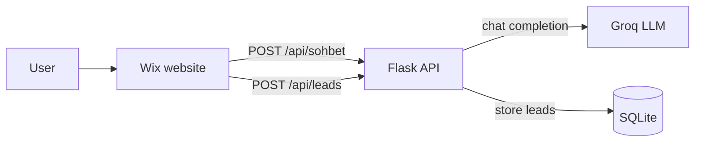

# Locisight — Backend API

**English** | [Türkçe](README.tr.md)

**Locisight** is an AI-powered location advisor for home seekers. Instead of filtering listings by
"number of rooms" or "square meters", users simply describe what they need in plain language —
*"a home with low earthquake risk for a family with two kids"* — and an AI assistant helps them
clarify their priorities and connects them with a real estate expert.

This repository contains the **backend REST API**. The user-facing website is built on
[Wix](https://www.wix.com) and talks to this API over HTTP.


---

## Features

- **Natural-language chat** — free-text conversations powered by an LLM (`openai/gpt-oss-120b` via the [Groq API](https://groq.com)), with multi-turn conversation history.
- **Domain-tuned assistant** — a system prompt focuses the assistant on lifestyle and environmental priorities (earthquake risk, access to green space, crime rate, budget).
- **Lead capture** — when a user is ready, their name, phone number and search criteria are stored so the sales team can follow up.
- **Protected admin endpoint** — reading leads requires a secret token, and the endpoint is disabled when no token is configured.
- **Demo mode** — runs without an API key, so you can try the API locally with no setup.

## Architecture



| Path | Responsibility |
|------|----------------|
| `run.py` | Entry point; creates the app via the factory |
| `config.py` | Settings loaded from environment variables and the assistant's system prompt |
| `app/__init__.py` | Application factory: config, CORS, database init, blueprint registration |
| `app/routes.py` | REST endpoints under `/api` |
| `app/services/ai_service.py` | Groq API client and conversation building |
| `app/database.py` | SQLite access for the `leads` table |

## Getting Started

### Prerequisites
- Python 3.10+
- A [Groq API key](https://console.groq.com/keys) (optional, without one the API runs in demo mode)

### Installation

```bash
git clone https://github.com/mertyerturun/locisight-backend.git
cd locisight-backend

python -m venv venv
source venv/bin/activate        # Windows: venv\Scripts\activate

pip install -r requirements.txt
cp .env.example .env            # then fill in your values
```

### Configuration

| Variable | Required | Description |
|----------|----------|-------------|
| `SECRET_KEY` | Yes (production) | Flask secret key; use a long random string |
| `GROQ_API_KEY` | No | Groq API key. If empty, `/api/sohbet` returns a demo response |
| `ADMIN_API_KEY` | Yes, to read leads | Secret token for `GET /api/leads`. If empty, the endpoint returns `503` |

Generate a strong token with:

```bash
python -c "import secrets; print(secrets.token_urlsafe(32))"
```

### Run

```bash
# Development
python run.py                   # http://localhost:5000

# Production
gunicorn run:app
```

Quick check:

```bash
curl http://localhost:5000/api/health
```

## API Reference

All endpoints are served under `/api`, and they accept and return JSON.
Field names are in Turkish: `mesaj` = message, `gecmis` = history, `cevap` = answer,
`isim` = name, `telefon` = phone, `kriter` = criteria, `basari` = success, `hata` = error.

### `GET /api/health`
Liveness check.

```json
{ "durum": "aktif", "mesaj": "Locisight sunucusu başarıyla çalışıyor." }
```

### `POST /api/sohbet` — chat with the assistant

**Request**
```json
{
  "mesaj": "İki çocuklu bir aile için deprem riski düşük bir semt arıyorum.",
  "gecmis": [
    { "mesaj": "Merhaba", "cevap": "Merhaba! Size nasıl yardımcı olabilirim?" }
  ]
}
```
`gecmis` (optional) holds previous turns, oldest first.

**Responses**
| Status | Body |
|--------|------|
| `200` | `{ "basari": true, "cevap": "..." }` |
| `400` | `{ "basari": false, "hata": "Mesaj alanı eksik." }`, `mesaj` missing |
| `503` | `{ "basari": false, "hata": "..." }`, LLM provider unreachable |

### `POST /api/leads` — save a contact request

**Request**
```json
{
  "isim": "Ayşe Yılmaz",
  "telefon": "05xx xxx xx xx",
  "mesaj": "Hafta içi akşam aranmak istiyorum.",
  "kriter": "Deprem riski düşük, okula yakın, bütçe 5M TL"
}
```
`isim` and `telefon` are required.

**Responses:** `201` on success, `400` if a required field is missing.

### `GET /api/leads` — list saved leads 🔒
Returns all leads, newest first, for the sales team. Requires the admin token:

```bash
curl -H "Authorization: Bearer $ADMIN_API_KEY" http://localhost:5000/api/leads
```

```json
{
  "basari": true,
  "veri": [
    { "id": 1, "isim": "...", "telefon": "...", "mesaj": "...", "kriter": "...", "tarih": "2026-08-06 19:55:06" }
  ]
}
```

| Status | Meaning |
|--------|---------|
| `200` | Success |
| `401` | Missing or invalid token |
| `503` | `ADMIN_API_KEY` is not configured on the server |

## Connecting from Wix

The Wix site calls this API with [Velo](https://dev.wix.com/docs/velo)'s `fetch`. Making the call from
a backend web module keeps the API URL and the admin token out of the browser, and avoids CORS issues:

```javascript
// backend/locisight.web.js
import { Permissions, webMethod } from 'wix-web-module';
import { fetch } from 'wix-fetch';
import { secrets } from 'wix-secrets-backend.v2';
import { elevate } from 'wix-auth';

const API_URL = 'https://<your-deployment>/api';

// Public: called from the chat widget on the site
export const chat = webMethod(Permissions.Anyone, async (mesaj, gecmis = []) => {
  const res = await fetch(`${API_URL}/sohbet`, {
    method: 'POST',
    headers: { 'Content-Type': 'application/json' },
    body: JSON.stringify({ mesaj, gecmis }),
  });
  return res.json();
});

// Admin only: the token lives in the Wix Secrets Manager as "LOCISIGHT_ADMIN_KEY"
// and never reaches the browser
export const listLeads = webMethod(Permissions.Admin, async () => {
  const getSecret = elevate(secrets.getSecretValue);
  const { value: adminKey } = await getSecret('LOCISIGHT_ADMIN_KEY');
  const res = await fetch(`${API_URL}/leads`, {
    headers: { Authorization: `Bearer ${adminKey}` },
  });
  return res.json();
});
```

## Deployment

The API is deployed on [Render](https://render.com) as a Python web service:

- **Build command:** `pip install -r requirements.txt`
- **Start command:** `gunicorn run:app`
- **Environment:** set `SECRET_KEY`, `GROQ_API_KEY` and `ADMIN_API_KEY`

> **Note:** SQLite is stored on the local filesystem, and Render's default filesystem is
> ephemeral. Attach a persistent disk, or switch to a managed database, to keep leads across deploys.

## Roadmap

- [x] Token authentication for the lead listing endpoint
- [ ] Rate limiting and input size limits on the chat endpoint
- [ ] Neighborhood dataset (earthquake risk, green space, crime rate) with retrieval-augmented generation (RAG), so answers are grounded in real data
- [ ] Automated tests and CI
- [ ] Managed database (PostgreSQL) for production

## Author

**Mert Yerturun** — [GitHub](https://github.com/mertyerturun)
