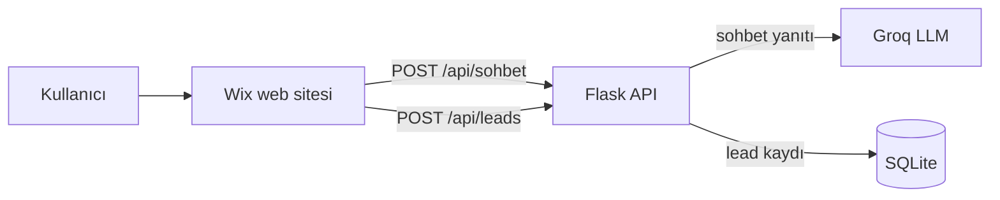

# Locisight — Backend API

[English](README.md) | **Türkçe**

**Locisight**, ev arayanlar için yapay zeka destekli bir lokasyon danışmanıdır. Kullanıcılar ilanları
"oda sayısı" veya "metrekare" gibi kalıplarla filtrelemek yerine, ihtiyaçlarını doğal bir dille anlatır:
*"iki çocuklu bir aile için deprem riski düşük bir ev"*. Yapay zeka asistanı da önceliklerini netleştirmelerine
yardımcı olur ve onları bir emlak uzmanıyla buluşturur.

Bu repo projenin **backend REST API**'sini içerir. Kullanıcıların gördüğü web sitesi
[Wix](https://www.wix.com) üzerinde geliştirilmiştir ve bu API ile HTTP üzerinden haberleşir.

**Canlı site:** https://mertyerturun.wixstudio.com/locisight


---

## Özellikler

- **Doğal dilde sohbet** — [Groq API](https://groq.com) üzerinden `openai/gpt-oss-120b` modeliyle çalışan, sohbet geçmişini hatırlayan serbest metin konuşmalar.
- **Alana özel asistan** — sistem promptu, asistanı yaşam tarzı ve çevresel önceliklere (deprem riski, yeşil alana erişim, suç oranı, bütçe) odaklar.
- **Müşteri adayı (lead) toplama** — kullanıcı hazır olduğunda adı, telefon numarası ve arama kriterleri kaydedilir; satış ekibi bu kayıtlarla geri dönüş yapar.
- **Korumalı yönetici endpoint'i** — lead kayıtlarını okumak gizli bir anahtar gerektirir; anahtar tanımlı değilse endpoint tamamen kapalı kalır.
- **Demo modu** — API anahtarı olmadan da çalışır, böylece API'yi hiçbir kurulum yapmadan lokalde deneyebilirsiniz.

## Mimari



| Dosya | Görevi |
|-------|--------|
| `run.py` | Giriş noktası; uygulamayı fabrika fonksiyonuyla oluşturur |
| `config.py` | Ortam değişkenlerinden okunan ayarlar ve asistanın sistem promptu |
| `app/__init__.py` | Uygulama fabrikası: ayarlar, CORS, veritabanı kurulumu, blueprint kaydı |
| `app/routes.py` | `/api` altındaki REST endpoint'leri |
| `app/services/ai_service.py` | Groq API istemcisi ve sohbet mesajlarının hazırlanması |
| `app/database.py` | `leads` tablosu için SQLite erişimi |

## Kurulum

### Gereksinimler
- Python 3.10+
- [Groq API anahtarı](https://console.groq.com/keys) (isteğe bağlı; anahtar yoksa API demo modunda çalışır)

### Adımlar

```bash
git clone https://github.com/mertyerturun/locisight-backend.git
cd locisight-backend

python -m venv venv
source venv/bin/activate        # Windows: venv\Scripts\activate

pip install -r requirements.txt
cp .env.example .env            # ardından kendi değerlerinizi girin
```

### Ortam Değişkenleri

| Değişken | Zorunlu mu? | Açıklama |
|----------|-------------|----------|
| `SECRET_KEY` | Evet (canlı ortamda) | Flask gizli anahtarı; uzun ve rastgele bir değer kullanın |
| `GROQ_API_KEY` | Hayır | Groq API anahtarı. Boşsa `/api/sohbet` demo yanıtı döner |
| `ADMIN_API_KEY` | Lead'leri okumak için evet | `GET /api/leads` için gizli anahtar. Boşsa endpoint `503` döner |

Güçlü bir anahtar üretmek için:

```bash
python -c "import secrets; print(secrets.token_urlsafe(32))"
```

### Çalıştırma

```bash
# Geliştirme
python run.py                   # http://localhost:5000

# Canlı ortam
gunicorn run:app
```

Hızlı kontrol:

```bash
curl http://localhost:5000/api/health
```

## API Referansı

Tüm endpoint'ler `/api` altındadır; JSON alır ve JSON döner.

### `GET /api/health`
Sunucunun ayakta olup olmadığını kontrol eder.

```json
{ "durum": "aktif", "mesaj": "Locisight sunucusu başarıyla çalışıyor." }
```

### `POST /api/sohbet` — asistanla sohbet

**İstek**
```json
{
  "mesaj": "İki çocuklu bir aile için deprem riski düşük bir semt arıyorum.",
  "gecmis": [
    { "mesaj": "Merhaba", "cevap": "Merhaba! Size nasıl yardımcı olabilirim?" }
  ]
}
```
`gecmis` (isteğe bağlı) önceki mesajlaşmaları eskiden yeniye doğru içerir.

**Yanıtlar**
| Durum | Gövde |
|-------|-------|
| `200` | `{ "basari": true, "cevap": "..." }` |
| `400` | `{ "basari": false, "hata": "Mesaj alanı eksik." }`, `mesaj` alanı yok |
| `503` | `{ "basari": false, "hata": "..." }`, yapay zeka servisine ulaşılamadı |

### `POST /api/leads` — iletişim talebi kaydetme

**İstek**
```json
{
  "isim": "Ayşe Yılmaz",
  "telefon": "05xx xxx xx xx",
  "mesaj": "Hafta içi akşam aranmak istiyorum.",
  "kriter": "Deprem riski düşük, okula yakın, bütçe 5M TL"
}
```
`isim` ve `telefon` zorunludur.

**Yanıtlar:** başarılıysa `201`, zorunlu alan eksikse `400`.

### `GET /api/leads` — kayıtlı lead'leri listeleme 🔒
Satış ekibi için tüm kayıtları en yeniden eskiye doğru döner. Yönetici anahtarı gerektirir:

```bash
curl -H "Authorization: Bearer $ADMIN_API_KEY" http://localhost:5000/api/leads
```

```json
{
  "basari": true,
  "veri": [
    { "id": 1, "isim": "...", "telefon": "...", "mesaj": "...", "kriter": "...", "tarih": "2026-08-06 19:55:06" }
  ]
}
```

| Durum | Anlamı |
|-------|--------|
| `200` | Başarılı |
| `401` | Anahtar eksik veya hatalı |
| `503` | Sunucuda `ADMIN_API_KEY` tanımlı değil |

## Wix Bağlantısı

Wix sitesi bu API'yi [Velo](https://dev.wix.com/docs/velo)'nun `fetch` fonksiyonuyla çağırır. Çağrıyı bir
backend web modülünden yapmak, API adresini ve yönetici anahtarını tarayıcıdan uzak tutar ve CORS sorunlarını önler:

```javascript
// backend/locisight.web.js
import { Permissions, webMethod } from 'wix-web-module';
import { fetch } from 'wix-fetch';
import { secrets } from 'wix-secrets-backend.v2';
import { elevate } from 'wix-auth';

const API_URL = 'https://<sunucu-adresiniz>/api';

// Herkese açık: sitedeki sohbet bileşeninden çağrılır
export const chat = webMethod(Permissions.Anyone, async (mesaj, gecmis = []) => {
  const res = await fetch(`${API_URL}/sohbet`, {
    method: 'POST',
    headers: { 'Content-Type': 'application/json' },
    body: JSON.stringify({ mesaj, gecmis }),
  });
  return res.json();
});

// Sadece yönetici: anahtar Wix Secrets Manager'da "LOCISIGHT_ADMIN_KEY" adıyla saklanır
// ve tarayıcıya hiçbir zaman ulaşmaz
export const listLeads = webMethod(Permissions.Admin, async () => {
  const getSecret = elevate(secrets.getSecretValue);
  const { value: adminKey } = await getSecret('LOCISIGHT_ADMIN_KEY');
  const res = await fetch(`${API_URL}/leads`, {
    headers: { Authorization: `Bearer ${adminKey}` },
  });
  return res.json();
});
```

## Yayına Alma (Deployment)

API, [Render](https://render.com) üzerinde bir Python web servisi olarak çalışır:

- **Build komutu:** `pip install -r requirements.txt`
- **Start komutu:** `gunicorn run:app`
- **Ortam değişkenleri:** `SECRET_KEY`, `GROQ_API_KEY` ve `ADMIN_API_KEY` tanımlayın

> **Not:** SQLite dosyası sunucunun yerel diskinde tutulur ve Render'ın varsayılan diski kalıcı değildir.
> Lead'lerin her deploy'da silinmemesi için kalıcı bir disk ekleyin ya da yönetilen bir veritabanına geçin.

## Yol Haritası

- [x] Lead listeleme endpoint'i için anahtar ile kimlik doğrulama
- [ ] Sohbet endpoint'i için istek sınırlama (rate limiting) ve mesaj boyutu sınırı
- [ ] Yanıtların gerçek veriye dayanması için mahalle veri seti (deprem riski, yeşil alan, suç oranı) ve RAG (retrieval-augmented generation)
- [ ] Otomatik testler ve CI
- [ ] Canlı ortam için yönetilen veritabanı (PostgreSQL)

## Geliştirici

**Mert Yerturun** — [GitHub](https://github.com/mertyerturun)
